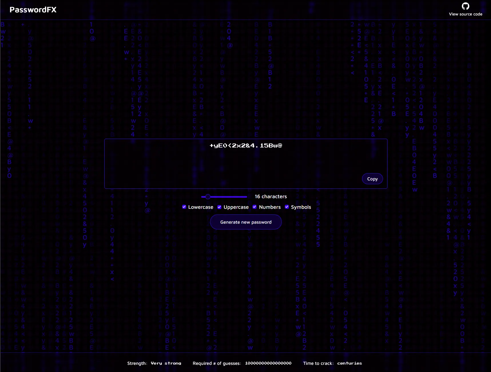

# PasswordFX

Visit here: https://theodoremoreland.github.io/PasswordFX/

## Table of contents

- [Overview](#overview)
- [Technologies used](#technologies-used)
- [Screenshots](#screenshots)
  - [Desktop](#desktop)
  - [Mobile](#mobile)

## Overview

Generate passwords and review their strength.

## Technologies Used

- HTML5
- CSS3
- JavaScript (ES6)
- Vite
- zxcvbn

## Screenshots

### Desktop

### Mobile

